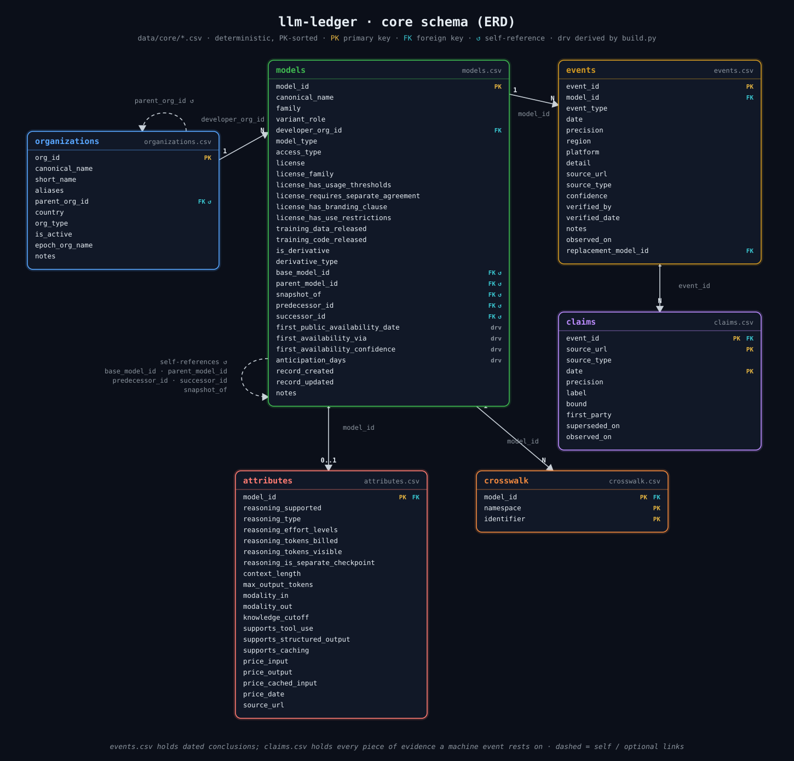

# llm-ledger schema

Six core tables, observation tables (`data/observations/`) and
generated files. CSVs are UTF-8, LF, sorted by
primary key, ISO dates. The code of record is `pipeline/schema.py`.

`erd.svg` is a hand-maintained drawing (one `<text>` element per column);
update it in the same change as any column added to or removed from
`pipeline/schema.py`.

## Rules

1. Epoch's size and compute numbers stay out of core. We join them in
   the enrichment file only.
2. Events are rows. A new event type does not need a new column.
3. Every date needs `source_url`, `precision`, and `confidence`.
4. If the source says "April 2023", we store `2023-04-01` and
   `precision=month`. We do not invent a day.
5. If sources disagree, we keep both. We do not pick in silence.
6. Fixes edit the row. `record_created` / `record_updated` and
   `CHANGELOG.md` keep history.
7. Generated files must rebuild the same from the same snapshots.

## Who gets in

A named trained checkpoint from a lab. GGUF, LoRA, and merges stay
out unless the thing is famous on its own. If we keep a derivative,
we set `is_derivative`, `derivative_type`, and `base_model_id`.
The Hub census also fills `base_model_id` on uncurated rows from a
repo's `base_model:` tags, only when every tagged base resolves to one
ledger model and the link closes no cycle.

Also out, enforced by the loaders (`match.is_alias_key`,
`match.is_out_of_scope_key`, `hf_census.classify`):

- packaging of the same weights: FP8, BF16, INT4/INT8, `-hf` and
  `-paddle` conversions collapse onto the base id (`match.FORMAT_TOKENS`);
- API aliases such as `-latest` or `deepseek-chat`, which point at
  whatever the vendor serves today;
- image, video and music generators, embeddings, rerankers, speech
  utilities, moderation and reward models, named as such;
- another lab's weights re-hosted under a different namespace: a lead in
  the review queue, never a release by the re-hoster. A name that carries
  another lab's family token under the publisher's own name is a
  `finetune` derivative.

A base checkpoint and its instruct or chat checkpoint are two models.

## organizations.csv

| Column | Type | Rules |
|---|---|---|
| `org_id` | string PK | slug, stable, never reused (e.g. `alibaba`, `openai`) |
| `canonical_name` | string | e.g. "Alibaba Cloud" |
| `short_name` | string | chart-friendly, e.g. "Alibaba" |
| `aliases` | pipe-separated list | all observed spellings and lab names |
| `parent_org_id` | FK nullable | subsidiaries/labs point to parent |
| `country` | ISO 3166-1 alpha-2 | headquarters; coding aligned with Epoch |
| `org_type` | enum | `big_tech, ai_lab, startup, academic, government, nonprofit` |
| `is_active` | bool (`true`/`false`) | |
| `epoch_org_name` | string nullable | exact organization string used by Epoch, for joining |
| `notes` | string | |

## models.csv

| Column | Type | Rules |
|---|---|---|
| `model_id` | string PK | slug, stable, never reused (e.g. `openai-o3`) |
| `canonical_name` | string | display name |
| `family` | string | e.g. `GPT-5`, `Claude 4`, `Qwen3`. Read off the name (`schema.family_and_role`: size, role, tier, format and date tokens removed) unless the model is curated (see below), whose value stands |
| `variant_role` | enum nullable | `base, mini, nano, pro, thinking, instruct, chat, coder, vision`; same derivation as `family`; empty when the name does not say |
| `developer_org_id` | FK to organizations | |
| `model_type` | enum | `llm, vlm, multimodal, image_gen, video_gen, audio, embedding` |
| `access_type` | enum | `open_weights, api_only, consumer_only, internal, never_released` |
| `license` | string | exact SPDX identifier or license name |
| `license_family` | enum | `proprietary, open_weights_restricted, osi_approved, permissive`. `permissive` grants use without restriction but is not OSI-approved (`openmdw-1.0`, `openmdw-1.1`, `cc0-1.0`, `cc-by-4.0`; `schema.LICENSE_PERMISSIVE`) |
| `license_has_usage_thresholds` | bool | revenue/user-count clauses |
| `license_requires_separate_agreement` | bool | commercial licence required |
| `license_has_branding_clause` | bool nullable | the license makes derivatives display the licensor's mark ("Built with Llama", a `Llama` name prefix). Notice-retention (Apache `NOTICE`, Llama 2's notice file) and trademark reservations are not branding |
| `license_has_use_restrictions` | bool nullable | the license forbids named uses (an acceptable-use policy, RAIL Attachment A, non-commercial terms) |
| `training_data_released` | enum nullable | `true, false, partial`: whether the data of every stage that produced the checkpoint is public, the base model's included. `partial`: some stages or subsets only, or behind a gate (BLOOM's ROOTS, Marin's `bigcode/starcoderdata`) |
| `training_code_released` | enum nullable | `true, false, partial`, same scope as `training_data_released` |
| `is_derivative` | bool | |
| `derivative_type` | enum nullable | `finetune, distill, quantization, merge, continued_pretrain` |
| `base_model_id` | FK nullable | |
| `parent_model_id` | FK nullable | e.g. `openai-o3-pro` points to `openai-o3` |
| `snapshot_of` | FK nullable | dated snapshot points to its alias parent |
| `predecessor_id` / `successor_id` | FK nullable | lineage |
| `first_public_availability_date` | date DERIVED | see derived-field rules |
| `first_availability_via` | enum DERIVED | which event won |
| `first_availability_confidence` | enum DERIVED | `confidence` of the event that set the date; empty when undated |
| `anticipation_days` | int DERIVED | first availability minus announced |
| `record_created` / `record_updated` | ISO datetime | |
| `notes` | string | ends with `openness: <urls>` when the four openness columns are filled: the model card and license text they were read from |

The four openness columns are blank until a person has read the license
and the release's data and code statements; blank means unchecked, not
`false`. They are filled for the fully open families (OLMo, OLMo 2, OLMoE,
Olmo 3, Pythia, SmolLM2, SmolLM3, BLOOM/BLOOMZ, Marin, Tulu 2 and Tulu 3).

Derived columns are recomputed by `pipeline/build.py` on every run and must
never be hand-edited. Filter on `events.confidence` (or
`first_availability_confidence`) before treating a model's dates as settled;
most rows are single-source catalog drafts. A model whose verified event was
read from a primary page (any non-machine `source_type`) is curated: loaders
never rewrite its `family`, `variant_role` or `access_type`
(`confidence.curated_model_ids`).

## events.csv (the heart of the dataset)

| Column | Type | Rules |
|---|---|---|
| `event_id` | string PK | `{model_id}-{event_type}-{seq}` |
| `model_id` | FK | |
| `event_type` | enum | see event vocabulary below |
| `date` | ISO date | first day of period when precision is coarser than day |
| `precision` | enum | `day, month, quarter, year` |
| `region` | string | default `global`; else ISO country or `EU`/`US`/`CN` |
| `platform` | enum nullable | one of `schema.PLATFORMS` (`openrouter, azure, bedrock, vertex, together, groq, fireworks, deepinfra, sagemaker, github_models, huggingface`); required on `platform_availability`; optional elsewhere to scope an event to one host (a `retired` on `azure` is not a retirement at OpenAI). Empty means the vendor's own channel. |
| `detail` | string nullable | event-type-specific, see below |
| `source_url` | URL | REQUIRED; the page actually consulted, or the chosen source when several claims back the row (see `claims.csv`) |
| `source_type` | enum | `vendor_blog, vendor_docs, vendor_changelog, deprecation_page, system_card, arxiv, hf_hub, github, modelscope, api_metadata, lifecycle_table, news, wikipedia, community_timeline, published_paper, wayback` |
| `confidence` | enum | `verified, inferred, disputed` (see confidence semantics) |
| `verified_by` | string | required when `confidence=verified`; a person's name, `llm-ledger` for a machine corroboration or a project-curated row, or `llm-ledger-agent` when the project's LLM agent read the page (set on every agent row, `inferred` ones included, to name the writer) |
| `verified_date` | date | required when `confidence=verified` |
| `notes` | string | REQUIRED when `confidence=disputed`: all conflicting values and sources. Machine rows carry the policy verdict (`single source: ...`, `corroborated within Nd: ...`) |
| `observed_on` | ISO date | REQUIRED; the day the ledger first recorded this event (the pull, feed read or edit that added it), not the day the event happened. Kept when the row is re-assessed or re-dated |
| `replacement_model_id` | FK nullable | the model the vendor tells users to move to; only on `deprecation_announced` and `retired`, never the model itself. Machine-filled from the Azure schedule's `Replacement` column (one named model for the version that retires last; a list such as "fp8, bf16" is left blank) and from vendor deprecation pages the agent reads |

`date` says when something happened; `observed_on` says when the ledger
knew. The gap between them is how late a release was noticed, and
`observed_on` is what a point-in-time query ("what did the record say on
day D") filters on. Rows that predate the column carry the day of the
first commit that held their `event_id` (2026-08-25 for the initial
publication); `build.py` stamps today on any row written without one.

Rows with `source_type` in `{hf_hub, api_metadata, lifecycle_table}` are
**machine-owned**: the loaders re-assess them on every run from the claims
in `claims.csv`. Any other `source_type` marks a curated row that no script
will ever modify.

`detail` conventions:

- `feature_added`: one of `vision, voice, tool_use, long_context,
  web_browsing, file_upload, structured_output`.
- `price_changed`: `input:old->new;output:old->new` in USD per 1M tokens.
- `renamed`: `old->new`.
- `license_changed`: `old->new` license tags, required. `date` is the day
  the new terms took effect; `models.license` holds the current tag.
- `version_observed`: the new version id, required: a Hub commit sha for
  `hf_hub` rows, the API snapshot id for `api_metadata` rows.
- `retired`: optional `served_by=<partner> (<sku>)`
  when a platform's schedule lists the model under a serving partner (Azure
  Foundry's `FW-` SKUs are served by Fireworks AI; the event stays on
  `platform=azure`).

## Event type vocabulary

| `event_type` | Definition |
|---|---|
| `announced` | First official public statement of the model's existence |
| `preview` | Limited/waitlist/safety-tester access begins |
| `paper_published` | arXiv **v1** submission date (never a later revision) or proceedings date |
| `system_card` | System/model card published (distinct from the paper) |
| `api_preview` | Available via API in preview/beta |
| `api_ga` | Generally available via the vendor's API |
| `weights_released` | Weights publicly downloadable (HF/ModelScope/GitHub timestamp) |
| `consumer_rollout` | Available in a consumer product to paid users |
| `free_tier` | Available to free-tier consumer users (mass-adoption moment) |
| `platform_availability` | GA on a third-party cloud platform (`platform` required) |
| `price_changed` | Official per-token price change |
| `feature_added` | Capability added to an existing model |
| `alias_repointed` | A vendor alias repointed to a new snapshot |
| `renamed` | Public product/model renamed |
| `deprecation_announced` | Vendor announces future retirement |
| `retired` | Model actually turned off / removed |
| `license_changed` | The terms the weights are distributed under changed |
| `version_observed` | A new Hub revision or API snapshot id was first seen for the model |

Why events, not a single "release date": GPT-3's paper went to arXiv on
May 28, 2020 but the API beta opened June 11, 2020. o3 was announced
December 20, 2024, released in the API April 16, 2025, and o3-pro followed
June 10, 2025. Collapsing these into one undocumented date is how existing
datasets disagree with each other.

## claims.csv (evidence behind machine-assessed events)

| Column | Type | Rules |
|---|---|---|
| `event_id` | FK to events | |
| `source_url` | URL | one live row per (event, source host) |
| `source_type` | enum | same vocabulary as events |
| `date` | ISO date | what this source says |
| `precision` | `day` or `year` | `year` for catalog Jan-1 placeholders |
| `label` | string | short source name, e.g. `models.dev`, `hub repo created` |
| `bound` | bool | the timestamp brackets the event (repo or model-registry creation, first crawl) rather than stating it |
| `first_party` | bool | the source reports its own event (OpenRouter listing on OpenRouter, Azure retirement on Azure) |
| `superseded_on` | ISO date or empty | empty: what the source says now. Set: what it said until that day, when a pull found it stating a different date |
| `observed_on` | ISO date | the day a pull first read this statement; unchanged while the source keeps saying it, so `observed_on`..`superseded_on` is the span the source stood behind the date |

Primary key: `(event_id, source_url, date)`.

`events.csv` holds the conclusion; this table holds every claim it rests on,
so a loader can re-assess from the live set and a reader can see exactly
which sources said what. Curated events have no rows here.

When a source moves its date (Azure pushes a retirement back, a catalog
corrects a release date) the old row is not overwritten: it stays with
`superseded_on` set to the pull date that saw the change, and the new
statement becomes the live row. Only live rows are evidence; the
superseded ones are the dated history of what each source said, and
`data/generated/reschedules.csv` reads them out as one row per move.

## crosswalk.csv

| Column | Type | Rules |
|---|---|---|
| `model_id` | FK | |
| `namespace` | enum | `openrouter, models_dev, huggingface, modelscope, openai_api, anthropic_api, google_api, mistral_api, epoch, wikipedia, lmarena, text_surface_forms, openalex, semantic_scholar` |
| `identifier` | string | the ID/name in that namespace; for `text_surface_forms`, one row per observed human spelling |

Primary key is the full triple, so a model may carry several identifiers per
namespace (e.g. many surface forms). `openalex` and `semantic_scholar`
name the work id of the model's paper, written by `pull_citations.py`;
they are not names of the model, so they never resolve an id to a model
and several models may share one paper.

## attributes.csv (serving + reasoning snapshot; one row per model)

| Column | Type |
|---|---|
| `model_id` | FK |
| `reasoning_supported` | bool nullable (catalogs say whether a model reasons) |
| `reasoning_type` | `none, always_on, toggleable, effort_tiered`, nullable (how it reasons is a human call) |
| `reasoning_effort_levels` | pipe-list nullable |
| `reasoning_tokens_billed` | bool nullable |
| `reasoning_tokens_visible` | `hidden, summarized, full` nullable |
| `reasoning_is_separate_checkpoint` | bool nullable |
| `context_length` | int |
| `max_output_tokens` | int nullable |
| `modality_in` / `modality_out` | pipe-lists of `text, image, audio, video, pdf` |
| `knowledge_cutoff` | ISO date nullable |
| `supports_tool_use` / `supports_structured_output` / `supports_caching` | bool nullable |
| `price_input` / `price_output` / `price_cached_input` | USD per 1M tokens, nullable |
| `price_date` | date the prices were observed |
| `source_url` | URL |

Price *history* lives in `events.csv` as `price_changed` rows; this table
holds only the latest observed snapshot. Rows with `source_url` =
models.dev were filled from that catalog by `reconcile.py` and are only
added for models without a hand-written row.

## data/observations/ (what each source listed, day by day)

Written by `pipeline/observe.py` from the daily pull payloads; never
hand-edited. Observations are facts about a source on a day, kept apart
from events (conclusions) and claims (statements about one event).

A row is a **run**: the source showed these values on every day from
`first_observed` to `last_observed`, inclusive. A day the source was not
pulled ends every run, so a run never spans a day nobody looked. An id
absent from a day the source was pulled was not listed that day. Values
are copied as the source states them; prices keep the source's unit.

Shared columns:

| Column | Type | Rules |
|---|---|---|
| `source` | enum | `models_dev, openrouter, litellm, litellm_git, openai_api, anthropic_api, google_api, mistral_api, hf` |
| `provider` | string | who serves the id: the models.dev provider key, `openrouter`, LiteLLM's `litellm_provider`, the vendor, or `huggingface` |
| `api_id` | string | the id exactly as the source lists it (a Hub repo id for `hf`) |
| `model_id` | FK nullable | resolved on every run: an exact crosswalk identifier, else the normalized key when it names one model (Hub repos resolve only exactly); blank when no ledger model matches |
| `first_observed` / `last_observed` | ISO date | the run's first and last day |
| `source_url` | URL | the payload URL from the manifest of the run's first day |

Primary key: `(source, provider, api_id, first_observed)`.

| Table | Extra columns |
|---|---|
| `availability_observations.csv` | none: a run is a span of days the id was listed. LiteLLM is a client library's price table, not a listing, and contributes none |
| `price_observations.csv` | `price_input`, `price_output`, `price_cached`, `currency`, `unit` (`per_1m_tokens` for models.dev, `per_token` for OpenRouter and LiteLLM). A source that rewrites a number's notation (LiteLLM's `0.00003` became `3e-05` on 2025-05-29) starts a new run at the same price; `price_changes.csv` compares converted values and does not count it |
| `capability_observations.csv` | `context_length`, `max_output`, `modalities_in`, `modalities_out` (pipe-lists), `tool_use`, `structured_output`, `reasoning` (bool, blank when the source does not say) |
| `model_versions.csv` | `version_kind`, `version_id`, `stated_date` (below) |
| `download_observations.csv` | `downloads_30d` (the Hub's rolling 30-day count; blank for ModelScope), `downloads_all_time` (cumulative; blank in hub-stats revisions before the column existed). Sources `hub_stats` (one day a week, the first `hub-stats` upload of the ISO week, since 2024-07-29) and `modelscope` (each daily sweep; `provider` is the ledger org, and a repo resolves through its Hub twin: same org, same repo name). Only repos that resolve to a ledger model get rows |

`model_versions.csv` holds the version a source states for an id, so a
result can name what was served:

| `version_kind` | Source | `version_id` | `stated_date` |
|---|---|---|---|
| `hf_revision` | `hf` | the repo's head commit sha | the commit day (Hub `lastModified`) |
| `api_snapshot` | `openai_api`, `anthropic_api` | the id itself, when it carries a snapshot date (`gpt-4o-2024-08-06`, `claude-haiku-4-5-20251001`) | the registry's created date |
| `api_snapshot` | `google_api` | the registry's `version` field, verbatim (`001`, `3.5-flash-05-2026`; for `-latest` aliases Google returns a display name there) | blank: the registry gives none |

A new sha is a new commit, which may change only the model card, not the
weights; no `version_observed` event is drawn from it. Mistral's dated
ids (`codestral-2508`) are not yet recognised as snapshots. Hub revisions
start with the first daily pull after `pull_hf.py` began recording `sha`;
the archived sweeps before it carry none.

Coverage starts 2026-10-03, the oldest archived raw snapshot; earlier
pulls kept manifests only. The exception is `litellm_git`: LiteLLM's
price table read from its git history, one copy per day from 2023-09-06
to 2026-10-02 (the day before the daily `litellm` pull begins), each the
file at the last commit on `main` that day. A run of it starts on the
day LiteLLM committed a value, which is on or after the day the provider
set it. The full payloads are archived as
`raw-YYYY-MM-DD` releases of the agent repository, and
`agent/backfill_observations.sh` there rebuilds these tables from them.

### usage_observations.csv

Written by `pipeline/pull_openrouter_rankings.py` from OpenRouter's Data
API (`rankings-daily`, CC BY 4.0). One row per day and model among the 50
public models that processed the most tokens on OpenRouter that day, plus
one `other` row for all the rest. Each pull re-reads every day since
2025-01-01 and rewrites the file.

| Column | Type | Rules |
|---|---|---|
| `date` | ISO date | the ranking day (UTC) |
| `model_permaslug` | string | OpenRouter's dated slug as the API states it (`deepseek/deepseek-v4-flash-20260423`, variants keep their `:free` suffix); `other` for the remainder row |
| `model_id` | FK nullable | the permaslug's model id from OpenRouter's archived `/models` listings (`canonical_slug`), then the crosswalk; blank for `other` and unmatched slugs |
| `total_tokens` | integer | tokens that day, exactly as stated |
| `rank` | integer | position among the day's named models by tokens; blank for `other` |
| `day_total_tokens` | integer | sum of every row of the day, `other` included; a share is `total_tokens / day_total_tokens` |
| `as_of` | timestamp | the API's `meta.as_of` for the response the row came from |
| `source_url` | URL | the request, without credentials |

A model missing from a day was not in that day's top 50; it is not zero.
OpenRouter is one router among many: these are shares of OpenRouter
traffic, not of the market. Cite as "Source: OpenRouter
(openrouter.ai/rankings), as of `<as_of>`. Licensed under CC BY 4.0."
Validation rule 18 checks one `other` row per day and that the day total
sums the rows.

### citation_observations.csv

Written by `pipeline/pull_citations.py` from OpenAlex (CC0) and Semantic
Scholar. One row per model, paper, source and citing year; the file is
rewritten on each run.

| Column | Type | Rules |
|---|---|---|
| `model_id` | FK | |
| `arxiv_id` | string | the model's paper |
| `linked_by` | enum | `paper_published_event` (the arXiv URL of the model's `paper_published` event), else `epoch_link` (the arXiv link Epoch AI gives the model), else `hf_card_arxiv_tag` (the single `arxiv:` tag across the model's Hub repos; repos tagging several papers are left out) |
| `source` | enum | `openalex`, `semantic_scholar` |
| `work_id` | string | the source's id for the paper |
| `year` | integer nullable | citing year; blank for the total |
| `citations` | integer | as the source states it |
| `observed_on` | ISO date | the day the source was read |
| `source_url` | URL | the work's page in that source |

Primary key: `(model_id, arxiv_id, source, year)`. OpenAlex states a total
and counts by citing year; Semantic Scholar a total only. The two count
differently (OpenAlex keeps an arXiv preprint apart from its journal
version, so its counts run lower) and neither is corrected toward the
other. A Hub tag can name a method paper or the base model's paper rather
than the model's own report, so a fine-tune may carry its base model's
count. Validation rule 19 checks that a row names a ledger model, a
known link kind and source, and a whole-number count.

### research_mentions.csv

Written by `pipeline/pull_research_mentions.py` from arXiv's OAI-PMH feed
(`arXivRaw`, sets cs.AI, cs.CL, cs.CV, cs.LG, stat.ML). One row per paper
version and model or family its title or abstract names; not a run of
days.

| Column | Type | Rules |
|---|---|---|
| `model_id` | FK nullable | the model a spelling names; blank for a family mention |
| `family` | string | the model's `family`, or the family named |
| `arxiv_id` / `version` | string | the paper and the version (`v3`) whose text was read |
| `submitted` | ISO date | that version's submission day |
| `matched_text` | string | the first spelling found, as written |
| `match_type` | enum | `model` (a spelling one model owns) or `family` |
| `source` | enum | `abstract` (title and abstract); `fulltext` is reserved |

Primary key: `(arxiv_id, version, model_id, family)`.

Matching is deterministic. Text is lower-cased and split into letter and
number runs ("Llama3.1-70B" = "Llama 3.1 70B"), then compared with the
ledger's spellings, longest first, without overlaps. Only spaces,
hyphens, underscores, `~` or one `:` may sit between the runs of one
spelling ("gemma3:27b", "Llama~3.3"); other punctuation or markup breaks
it ("step, (3", "phi^{4"). A word, a space and a bare number must be
capitalized: "Llama 3" matches, "step 3" and "llama 3" do not. A spelling
names a model when it is that model's `canonical_name` or an Epoch, Hub
(repo name), or vendor API identifier of that model alone. A family name,
or a `text_surface_forms` spelling equal to one, names the family: those
spellings stand for a whole series. Family values that differ only in
punctuation ("Llama 3.1", "Llama-3.1") are one family, recorded under the
spelling most models carry. A spelling needs a version or size digit:
bare names ("Qwen", "Claude", "GLM", "Phi") collide with ordinary words
and are skipped, so counts are a floor. Capitalized prose ("Step 3") can
still match a model name. arXivRaw carries only the
latest version's text, so a row is dated by that version; a paper's v1
may have said something else. A re-read of the same version replaces its
rows; a new version adds its own. `data/staging/research_harvest.json`
holds the harvested datestamp range (`harvested_from`,
`harvested_through`); papers submitted before `harvested_from` and not
revised since were not read. The daily run re-reads the last 30 days so a
model added to the ledger late is still found in its first month of
papers. arXiv metadata is CC0 1.0.

## Derived-field computation rules

- `first_public_availability_date` = MIN over global-region events of type
  `{api_ga, weights_released, consumer_rollout}`. If none exist, fall back to
  MIN of `{api_preview, free_tier}`, then to `platform_availability` (a
  third-party listing is an upper bound on public availability), and suffix
  `first_availability_via` with `_fallback`.
- Events at `quarter` or `year` precision never set
  `first_public_availability_date`; a model whose only availability claim
  is a catalog placeholder stays undated until a day- or month-precision
  event exists.
- `first_availability_via` = the event type that achieved the minimum; ties
  broken by priority `weights_released > api_ga > consumer_rollout`
  (fallback ties: `api_preview > free_tier > platform_availability`).
- Evidence beats tier once: when the chosen date is not `verified`, falls
  more than 180 days after the announcement (`LONG_GAP_DAYS`), and a
  person-verified availability event of any type is earlier, the earliest
  person-verified event sets the date instead (a reseller listing a model
  years after launch is not its launch).
- `first_availability_confidence` = the `confidence` of the event that set
  the date (`verified`, `inferred`, or `disputed`); empty when undated.
- `anticipation_days` = `first_public_availability_date - announced.date`;
  null if either is missing or either precision is coarser than `month`.
- All derived fields are recomputed by `pipeline/build.py` every run.

## Confidence semantics

One policy, `pipeline/confidence.py`, decides every machine-dated row:

| `confidence` | Meaning |
|---|---|
| `verified` | Either a person opened a primary source (`verified_by` = their name), or `verified_by=llm-ledger`: two independent machine sources agreed on the date within two days, or a platform reported its own event. |
| `inferred` | One machine source, or several that differ by 3-30 days. The row carries the best-evidenced date and lists the others in `notes`. An agent row (`verified_by=llm-ledger-agent`) is `inferred` while the page it read is its only source (`notes` start `single source`); it becomes `verified` when a catalog states the same date. |
| `disputed` | Two *stated* dates conflict by more than 30 days, or a year placeholder names a different year. All values recorded in `notes`; `date` keeps the best-evidenced value. A `first_party` record is never disputed by a third party: a differing mirror is noted (`differs:`), the first-party date stands as `verified`. |

Bracketing timestamps (`bound=true` in `claims.csv`: Hub repo creation,
ModelScope twin-repo creation, vendor model-registry `created`, first
Wayback capture) never set the date when a stated date exists, never count
as verified alone, and never dispute. A bound that trails the chosen date
by more than two days is lag (a late crawl, a mirror created later) and is
only noted; one that leads it keeps the row `inferred`. Among bounds, the
artifact's own timestamp outranks a twin repo or a crawl of it, and a
capture alone never dates a release. A capture that predates the repo's
creation belongs to a recreated or renamed repo and is discarded. Any
machine claim dated before a curated `announced` event is private
pre-staging and is withdrawn.

models.dev lists one model under many resellers. Its date is used only
when the vendor's own provider entry states it, or a strict majority of
resellers agree; a lone reseller yields an `inferred` claim labelled
`single`; disagreement with no majority yields no claim and a
`md_no_consensus` review-queue row.

## Generated artifacts (never hand-edited)

- `data/generated/llm_ledger_wide.csv` - one row per model; each event type
  pivoted to `{event_type}_date` + `{event_type}_precision` (global region
  only; repeatable event types pivot to their earliest occurrence), joined
  with models and attributes.
- `data/generated/llm_ledger_enriched.csv` - the wide file LEFT JOINed to an
  Epoch AI snapshot via the crosswalk, carrying Epoch's scale columns and
  confidence labels plus a constant `epoch_snapshot_date` column. Epoch data
  is CC BY 4.0 and credited in the README.
- `data/generated/models_latest.csv` - a reading view of `models.csv`:
  the identifying columns (`first_public_availability_date`,
  `first_availability_via`, `model_id`, `canonical_name`,
  `developer_org_id`, `family`, `variant_role`, `model_type`,
  `access_type`, `license_family`), sorted newest first
  (ties by `model_id`, undated models last). Values are identical to
  `models.csv`; the sparse curated columns stay there.
- `data/generated/coverage_report.md` - per-organization model and event
  counts with review status and verified share; read this before quoting
  the headline row counts.
- `data/generated/reschedules.csv` - one row per time a source moved
  its date for an event, from the superseded rows of `claims.csv`:
  `from_date`, `to_date`, signed `days_moved` (positive = slipped
  later), `observed_on` (the pull that saw the change), `first_party`.
  Platform retirement tables are where this happens most.
- `data/generated/market_on_date.csv` - the market on the newest
  observed day: one row per listing of a ledger model (availability run
  covering the day), with that source's price and limits for the same id
  on the same day. Prices are converted to `*_usd_per_1m` from the
  source's unit; OpenRouter's negative router marker is left blank.
  `observed_from` is the start of the unbroken run, never earlier than
  the first archived day. `python pipeline/market.py --date D` writes the
  same view for any observed day; the site's market page reads the runs
  and shows any day in the browser. Model fields (`access_type`,
  `license_family`) are today's values, not the day's.
- `data/generated/price_changes.csv` - one row per price change one
  source showed for one ledger-model id: two successive price runs with
  different prices (in USD per 1M), the change falling after
  `last_old_day` and on or before `first_new_day`. `first_party` is true
  when the provider is the model's developer (cloud resale keys such as
  `azure-openai` are not). Catalog diffs, not vendor announcements; a
  `price_changed` event in `events.csv` needs the vendor's own page.
- `data/generated/llm_ledger_capability.csv` - one row per Epoch
  Capabilities Index entry that names a ledger model, with the model's
  `access_type`, `license_family` and `first_public_availability_date`
  beside `eci` and its interval. The Epoch crosswalk id joins first
  (`matched_by=crosswalk`); otherwise the normalized ECI name must equal a
  ledger id that has no Epoch id of its own, and dated names such as
  "GPT-4o (Aug 2024)" never join by name (`matched_by=name`). One model can
  carry two entries when ECI scores two checkpoints. ECI publishes no index
  version and no per-model evaluation date, so `eci_snapshot_date` (the
  day the scores file was first archived) is the only version stamp;
  compare scores within one snapshot. ECI is CC BY 4.0 (Epoch AI,
  "Epoch Capabilities Index") and credited in the README.
- `data/generated/llm_ledger_benchmarks.csv` - one row per Epoch
  Benchmarking Hub result on a ledger model: `benchmark`, the evaluated
  `epoch_model_version` (an API id, often with a reasoning-effort suffix),
  Epoch's `epoch_row_id` and the `score` copied unchanged from the column
  `benchmark_metadata.csv` declares for that benchmark. A version joins
  through its Epoch model group by the same rule as the capability join,
  so one model carries a row per evaluated version. Benchmarks with no
  declared score column are left out rather than guessed, and rows whose
  source is Artificial Analysis are dropped (their terms forbid
  redistribution). `benchmark_in_eci` is true when ECI uses the benchmark;
  `epoch_snapshot_date` is the archive day. CC BY 4.0 (Epoch AI).
- `data/generated/llm_ledger_arena.csv` - one row per overall-category
  LMArena rating of a ledger model, per `arena` (`text`,
  `text_style_control`, `webdev`, `vision`) and leaderboard
  `publish_date`, with `rating`, its interval, `votes` and `rank` copied
  unchanged and the arena's own `arena_model` name. Ratings are refit at
  each publication, so compare models within one leaderboard, not one
  model across dates. `matched_by` is `name` (the name, effort qualifier
  folded, is a ledger id or a unique ledger spelling), `name_snapshot`
  (a dated arena name on the ledger id with that date) or
  `name_one_snapshot` (a dated name on the undated id, only when the arena
  lists that model under one date and never undated). Ambiguous names stay
  out. The dataset revision is the sha in the raw manifest URL. CC BY 4.0
  (LMArena, `lmarena-ai/leaderboard-dataset`).
- `data/generated/obsolescence.csv` - one row per ledger model seen on
  LMArena, in OpenRouter's daily top 50, or dropped from OpenRouter's
  listing while observed. Technical: on each leaderboard day the model's
  best `rank` across arenas; `arena_last_top30_date` is its last day at
  rank 30 or better and `technical_obsolete_date` the next day it appears
  below that, never to return (a model never in the top 30 is obsolete on
  `arena_first_date`; blank when its last appearance is still in the top
  30). Usage: `usage_obsolete_date` is the day after
  `openrouter_top50_last_date`, set only when the model has been out of
  the top 50 for at least 30 days through the latest ranking day.
  `openrouter_last_listed_date` is the last day OpenRouter listed it, set
  only when that is before the latest observed listing day (from
  2026-10-03). Ages count from `first_public_availability_date`. The rank
  and top-50 thresholds follow MIT FutureTech's study of model
  obsolescence (SSRN 7502833), which used a top-30 rank on LMArena for
  technical obsolescence. The ranking starts 2025-01-01, so
  `openrouter_top50_first_date` = 2025-01-01 means "already in the top
  50"; a negative age means the signal predates the ledger's availability
  date (a pre-release arena test, a late ledger date, or an arena name
  matched to the wrong model) and is worth a look.
- `data/generated/hub_descendants.csv` - one row per Hub repo of a ledger
  model and relation: `descendants` is how many public Hub repos name that
  repo as a direct base model with that relation (`finetune`, `quantized`,
  `merge`, `adapter`, as the Hub states it in `baseModels`), in the newest
  weekly `hub-stats` copy of the Hub's model list (`hub_stats_date`). A
  merge counts once toward each base. Counts, not one row per derivative;
  derivatives of derivatives count toward their own base, and untagged
  ones are not counted. Apache-2.0 (cfahlgren1, `hub-stats`).
- `data/generated/research_mentions_monthly.csv` - papers per family per
  month from `research_mentions.csv`: a paper counts once per family, in
  the month of the earliest version naming the family or a member.
  Counts are not normalized by arXiv's monthly volume.
- `data/generated/research_first_mentions.csv` - each model a paper names
  by its own spelling, with the first such paper (`first_mention`,
  `first_mention_arxiv_id`) beside `weights_released_date` and
  `first_public_availability_date`. `days_to_first_mention` counts from
  first public availability and is blank when the model was available
  before `harvested_from`. A negative value is a paper dated before the
  ledger's availability date: a pre-release paper, an availability date
  that is too late, or another model of the same name.
- `data/generated/sensitivity_report.md` - how far apart the candidate
  "release dates" of one model sit (announced vs api_ga vs
  weights_released ...), for researchers choosing a treatment date.
- `data/generated/matched_models.csv` and `disagreement_report.md` -
  the cross-catalog clusters `match.py` built and where the catalogs
  disagree; inputs to `reconcile.py`, not derived from the core tables.

Snapshot dates carried into artifacts (`epoch_snapshot_date`,
`attributes.price_date`) are the day the current payload first appeared,
not the day it was last pulled, so an unchanged upstream file does not
rewrite the dataset.

## Staging files (the review loop)

- `data/staging/review_queue.csv` - rows the loaders could not settle:
  `kind` (`fuzzy_match`, `md_no_consensus`, `hf_mirror_repo`,
  `hf_precreated_repo`, `hf_recreated_repo`, `hf_backfill_date`,
  `hf_unmapped_namespace`, `catalog_unmapped_vendor`, `vendor_alias_group`, `nhlocal_lead`,
  `lifecycle_ambiguous`, `long_announce_gap`, `predecessor_lead`,
  `announce_lead`, `paper_lead`, ...),
  the two keys involved, a score and a note. Rewritten by every run.
  A `predecessor_lead` (build.py) pairs a model with the one model at the
  next lower version of its family, same developer and same rest of the
  id (`glm-4-6` before `glm-4-7`, `gemini-3-flash` before
  `gemini-3-5-flash`); a person sets `predecessor_id` on the newer model
  and `successor_id` on the older (rule 20 checks both), or rejects it.
  Nothing writes these columns automatically. An
  `announce_lead` (pull_nhlocal.py) names a model with no `announced`
  event that the community timeline mentions, with the month as a hint
  for finding the maker's post; a `paper_lead` (pull_arxiv.py) is an
  arXiv paper whose title names a family with no `paper_published`
  event, submitted within 180 days before to 365 days after the
  family's first availability.
- `data/staging/review_decisions.csv` - append-only, hand-edited:
  `kind,left_key,right_key,decision,decided_by,decided_on,note` with
  `decision` in `accept` / `reject` / `dismiss`. A decided item is never
  queued again; an accepted `fuzzy_match` joins its cluster with method
  `reviewed`.

## Validation rules

`pipeline/validate.py` enforces, and exits nonzero on failure:

1. PK uniqueness on all tables; all FKs resolve (including
   `claims.event_id` and `events.replacement_model_id`).
2. Every event has a valid `source_url`, plus `precision` and `confidence`.
3. `date` is consistent with `precision` (month precision means day == 01,
   quarter means the first day of Jan/Apr/Jul/Oct, year means Jan 1).
4. Temporal sanity per model and region:
   `announced <= preview <= api_preview <= api_ga` where present;
   `deprecation_announced <= retired` within one platform scope (a host may
   retire a model before its vendor announces its own shutdown); availability
   more than 30 days before
   `announced` is an error (1-30 days a warning); no event after today
   except `retired` rows from published shutdown schedules (one summary
   warning).
5. `disputed` implies non-empty `notes`; `verified` implies `verified_by`
   and `verified_date`.
6. Every model has at least one event; every non-derivative model has an
   `announced`, availability, or `platform_availability` event.
7. `snapshot_of` / `base_model_id` / `parent_model_id` links are acyclic.
8. Controlled-vocabulary columns contain only allowed values; `platform` is
   present on every `platform_availability` row; every event and claim has
   an ISO `observed_on`, and a superseded claim was not superseded before
   it was observed; `license_changed` carries `old->new` and
   `version_observed` a version id in `detail`; `replacement_model_id`
   appears only on `deprecation_announced` and `retired` and never names
   the event's own model.
9. Wide/enriched artifacts, `models_latest.csv`, the coverage and
   sensitivity reports and the README stats block regenerate
   byte-identically from core tables.
10. No Epoch-domain numeric columns (parameters, compute, dataset size,
    training cost, ECI or benchmark scores) exist in any core table.
11. Every event whose `source_type` is machine-owned (`hf_hub`,
    `modelscope`, `api_metadata`, `lifecycle_table`) has at least one row in
    `claims.csv`; no other event has any.
12. A `(namespace, identifier)` in a machine namespace (everything but
    `wikipedia`, `text_surface_forms`, `lmarena`, `openalex`,
    `semantic_scholar`) maps to one model, or to
    a model and models whose `snapshot_of` or `parent_model_id` is that
    model.
13. `access_type=api_only` is incompatible with a `weights_released`
    event; `build.py` sets `open_weights` on machine rows that gain one.
14. A claim with `superseded_on` set has a live claim from the same
    source host on the same event: history hangs off a current statement.
15. An `open_weights` model may not carry `license_family=proprietary`;
    open-weight models with no `license_family` are a counted warning.
16. Observation runs have ISO bounds with `first_observed <=
    last_observed`, name a known model when `model_id` is set, and never
    overlap for one `(source, provider, api_id)`; a `model_versions` row
    has a known `version_kind` and a `version_id`.
17. A research mention is unique per `(arxiv_id, version, model_id,
    family)`, has an arXiv id, a `vN` version and a day, a known
    `match_type` and `source`, always a `family`, and a known `model_id`
    exactly when `match_type = model`.
18. Each `usage_observations` day has whole token counts, exactly one
    `other` row and a `day_total_tokens` equal to the sum of its rows;
    a set `model_id` is a known model.
19. A citation row names a known model, a `linked_by` in the vocabulary,
    source `openalex` or `semantic_scholar`, and a whole-number count.
20. `predecessor_id` and `successor_id` mirror each other: when A names B
    as its predecessor, B names A as its successor, and the reverse.

Churn guard (run by `pipeline/validate.py`, not part of the rule set): one
run may not remove more than 2% of the events committed at `HEAD`, nor
re-date more than 5% of them. Daily updates stay under 0.5% of either; a
deliberate migration passes `--allow-churn`.
